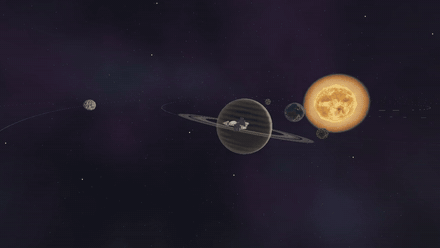
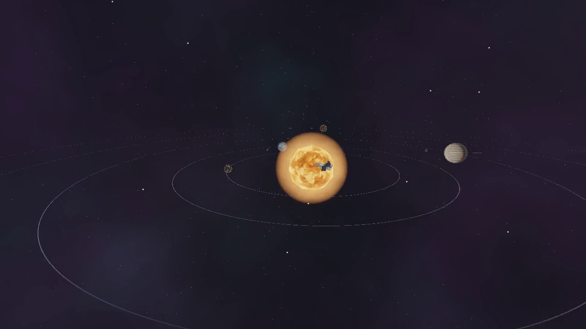
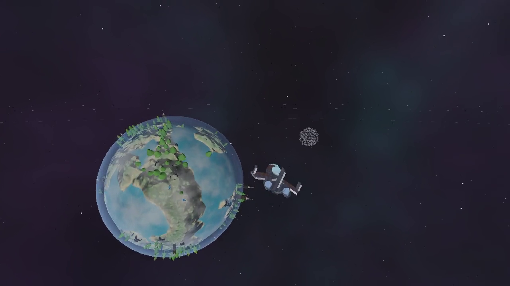
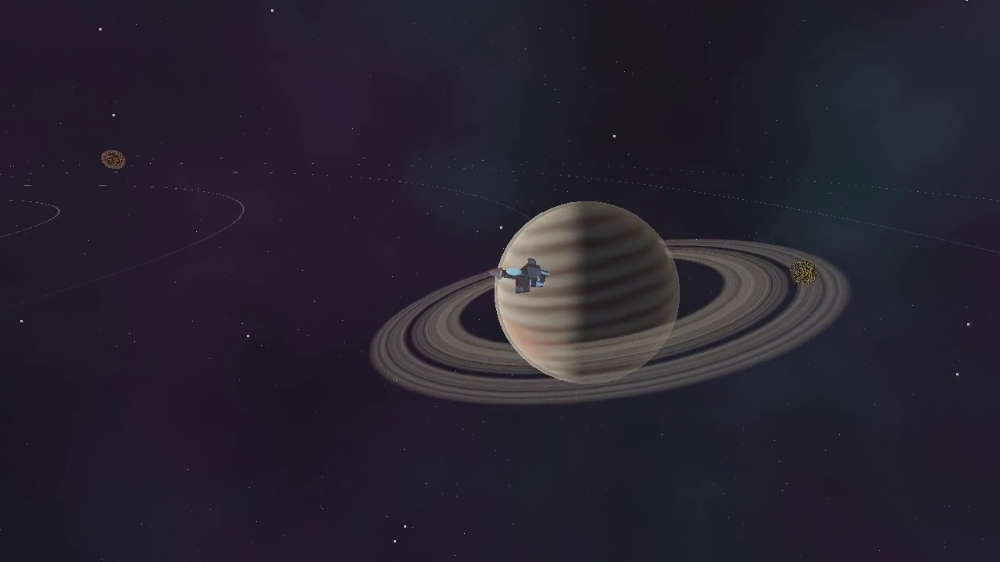
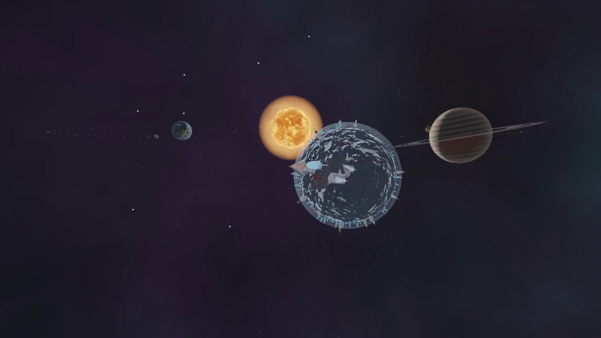
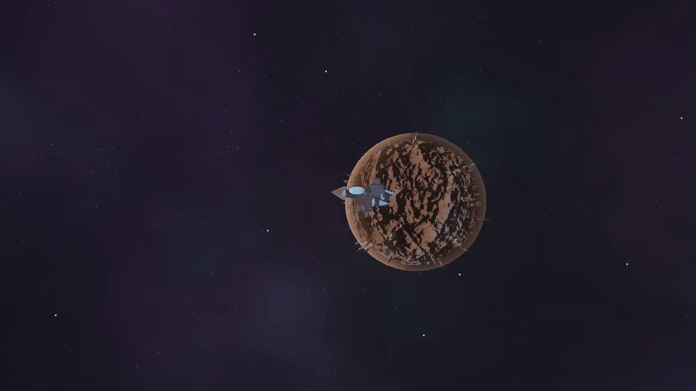
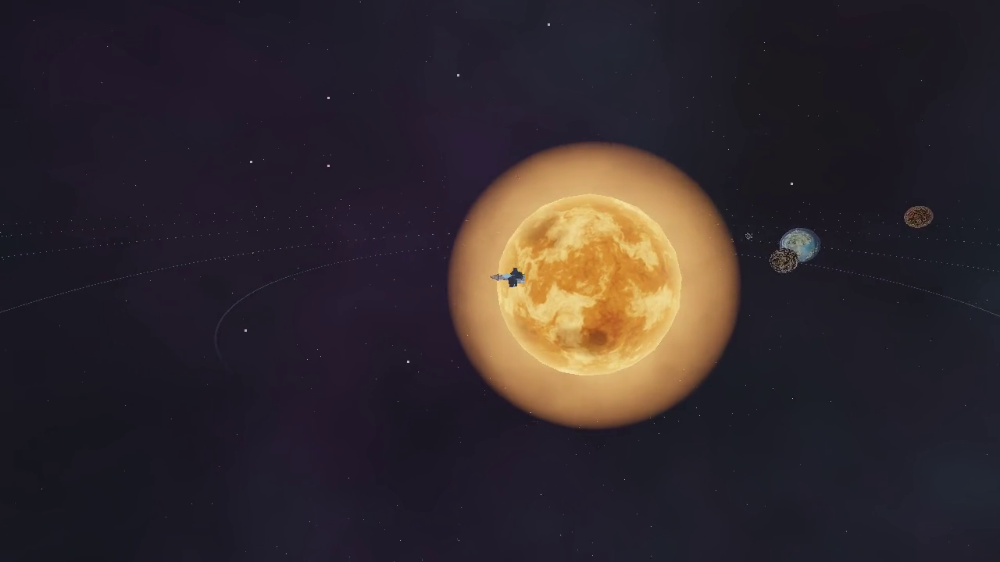

# Sistema solar HELIOS — renderizador por software

Simulación interactiva de un sistema solar inventado, dibujada con un
renderizador por software escrito desde cero en Rust. No se usa OpenGL,
Vulkan, DirectX ni ningún motor de juego o de física: las matrices, el
recorte, el rasterizado, la prueba de profundidad, los shaders, la
geometría y las texturas están implementados en este repositorio.

La única librería externa de peso es [`minifb`](https://crates.io/crates/minifb),
y solo hace tres cosas: abrir la ventana, decir qué teclas están
presionadas y mostrar en pantalla el bloque de píxeles que produjo el
renderizador. La otra, [`rayon`](https://crates.io/crates/rayon), reparte
el rasterizado entre los núcleos del procesador.

**Universidad del Valle de Guatemala — Gráficas por Computadora**

| Integrante | Carné / usuario |
|---|---|
| Harry Mendez | [@hmndz3](https://github.com/hmndz3) |
| Juan Gualim | [@JuanGualim](https://github.com/JuanGualim) — 24852 |

---

## Video



El recorrido completo, en alta calidad, está en
[`docs/recorrido.mp4`](docs/recorrido.mp4): vuelo espacial, acercamiento,
vuelta alrededor de cada planeta y alejamiento, sin cortes ni pantallas de
carga.

El video **no es una grabación de pantalla**: sale del mismo renderizador
que dibuja la ventana. El programa tiene un modo que recorre un guion de
cámara y entrega los cuadros a `ffmpeg` (ver
[Grabar el video](#grabar-el-video)).

---

## Capturas

| | |
|---|---|
|  |  |
| El sistema visto desde arriba del plano eclíptico | TERRANOVA: continentes, océano, nubes y bosques |
|  |  |
| AURORA: bandas con rotación diferencial y anillos | GELIDA: placas de hielo y bosque de cristal |
|  |  |
| VULCANO: cordilleras, rocas y monumentos | HELIOS: plasma con distorsión de dominio y corona |

---

## Cómo ejecutarlo

Hace falta [Rust](https://rustup.rs) (1.75 o superior). No hay que
instalar nada más: `minifb` y `rayon` son Rust puro y `cargo` las descarga
solo.

1. Abrir una terminal en la carpeta del proyecto.

```bash
cargo run --release
```

El primer arranque tarda unos segundos: ahí se generan los planetas, los
mapas de normales, la nebulosa y la siembra de objetos de superficie.
Después de eso todo es tiempo real.

Para correr las pruebas:

```bash
cargo test --release
```

---

## Controles

| Tecla | Acción |
|---|---|
| `W` / `S` | Empuje adelante / atrás |
| `A` / `D` | Guiñada (girar a los lados) |
| `↑` / `↓` | Cabeceo (subir y bajar la nariz) |
| `←` / `→` | Desplazamiento lateral |
| `Q` / `E` | Alabeo (girar sobre el eje de vuelo) |
| `Z` / `X` | Bajar / subir |
| `Shift` | Turbo |
| `Espacio` | Freno |
| `C` | Cambiar de cámara: persecución → cabina → orbital → libre |
| `L` | Modo de vuelo local (nivela la nave con la superficie cercana) |
| `Tab` | Seleccionar el siguiente cuerpo |
| `R` | Llevar la nave junto al cuerpo seleccionado |
| `G` | Gravedad encendida / apagada |
| `F` | Descarte por frustum encendido / apagado |
| `O` | Niveles de detalle encendidos / apagados |
| `P` | Objetos de superficie encendidos / apagados |
| `B` | Líneas de órbita |
| `N` | Atmósferas |
| `H` | Mostrar u ocultar el HUD |
| `,` / `.` | Simulación más lenta / más rápida |
| `9` / `0` | Bajar / subir la resolución de render |
| `Ctrl`+`Espacio` | Pausa |
| `Esc` | Salir |

En la cámara **orbital** las mismas teclas giran alrededor del cuerpo
seleccionado (`W`/`S` acercan y alejan). En la cámara **libre** la cámara
vuela por su cuenta y la nave se queda donde está.

`F` y `O` existen para la demostración: el HUD muestra cuántos triángulos
se envían, cuántos se rasterizan, cuántos se descartan por ser caras
traseras y cuántos quedan fuera de cuadro, así que se ve en números lo que
ahorra cada técnica.

---

## El sistema

Todo es procedural y depende de una sola semilla (`SEMILLA` en
[`src/main.rs`](src/main.rs)). Cambiarla produce otro sistema completo:
otro relieve, otras nebulosas, otra distribución de objetos.

| Cuerpo | Qué es | Rasgo propio |
|---|---|---|
| **HELIOS** | La estrella | Plasma con distorsión de dominio animada y corona |
| **FERRUM** | Planeta rocoso | Cráteres de ruido celular, sin atmósfera |
| **TERRANOVA** | Planeta con océano | Continentes, nivel del mar, nubes animadas y bosques |
| **SELENE** | Luna de TERRANOVA | Cráteres finos, en órbita inclinada |
| **AURORA** | Gigante gaseoso | Bandas con rotación diferencial, tormenta y anillos |
| **IO MENOR** | Luna de AURORA | Cordilleras volcánicas |
| **GELIDA** | Mundo helado | Placas de hielo, grietas y bosque de cristal |
| **VULCANO** | Planeta montañoso | Cordilleras de ruido de crestas, rocas y monumentos |

Los cinco planetas orbitan **exactamente sobre el plano eclíptico**
(inclinación cero); las lunas sí tienen su propia inclinación. Las líneas
de órbita que se dibujan dejan ver ese plano de un vistazo.

---

## Cómo funciona el renderizador

### El recorrido de un triángulo

1. **Etapa de vértices** ([`render/pipeline.rs`](src/render/pipeline.rs)).
   Cada vértice pasa de espacio de objeto a espacio de recorte con
   `proyección · vista · modelo`. Las normales se transforman con la
   traspuesta de la inversa, para que la escala no uniforme de los anillos
   no las tuerza.
2. **Recorte contra el plano cercano**
   ([`render/raster.rs`](src/render/raster.rs)). Un triángulo con un
   vértice detrás de la cámara se corta por el plano `z + w = 0` y se
   vuelve a triangular. Sin este paso, ese vértice se divide entre un `w`
   negativo y el triángulo se dibuja invertido a lo ancho de la pantalla.
3. **División perspectiva y paso a pantalla.** Se guarda `1/w` para la
   interpolación.
4. **Descarte de caras traseras.** Se mide el área con signo del
   triángulo ya proyectado; como la `y` de pantalla crece hacia abajo, las
   caras de frente quedan con área negativa.
5. **Relleno.** Coordenadas baricéntricas con funciones de borde
   incrementales, prueba de profundidad contra el z-buffer e
   **interpolación con corrección perspectiva**: los atributos se
   interpolan divididos entre `w` y al final se recupera el valor real.
6. **Fragment shader.** Recibe posición en mundo, posición en espacio de
   objeto, normal, coordenadas de textura, el canal libre del vértice y la
   profundidad, y devuelve color lineal más cobertura.

El framebuffer se parte en bandas horizontales y cada hilo escribe solo en
sus filas, así que el rasterizado es paralelo sin un solo bloqueo. El
ensamblado de triángulos (recorte, proyección y descarte) ocurre una sola
vez por triángulo, no una vez por banda.

El color se mapea con Reinhard y corrección gamma antes de empacarse, para
que el núcleo de la estrella y los reflejos del agua no se recorten a
blanco plano.

### Geometría

Los planetas **no se cargan de ningún archivo**: se generan. Se parte de
un icosaedro de 20 caras y se subdivide, proyectando cada punto nuevo
sobre la esfera ([`geometry/sphere.rs`](src/geometry/sphere.rs)). Un caché
de aristas evita duplicar vértices, así que la malla queda cerrada —hay
una prueba que lo verifica contando que cada arista aparezca en
exactamente dos triángulos—.

Después, cada vértice se desplaza a lo largo de su normal según el campo
de altura del planeta ([`geometry/terrain.rs`](src/geometry/terrain.rs)) y
se recalculan las normales. Eso es lo que hace que la silueta de VULCANO
no sea un círculo perfecto.

La nave y los cuatro modelos de superficie se arman uniendo cajas, conos,
cilindros y bipirámides transformadas
([`geometry/models.rs`](src/geometry/models.rs)).

### Ruido

Un solo módulo ([`src/noise.rs`](src/noise.rs)) con ruido de valor
trilineal e interpolación quíntica, suma de octavas (fBm), variante de
crestas, ruido celular y distorsión de dominio. Todo con semilla: con la
misma semilla salen las mismas montañas y los mismos árboles en cualquier
máquina.

### Mapeo de normales

Los mapas de normales se calculan al arrancar a partir del mismo campo de
altura que deformó la geometría
([`render/texture.rs`](src/render/texture.rs)). La pendiente se obtiene
por diferencias finitas sobre la esfera y se guarda codificada en `[0,1]`.

En el shader, la base tangente se construye **en espacio de objeto** y se
lleva a mundo con la matriz de normales, y se reortogonaliza contra la
normal interpolada (Gram-Schmidt). Si la base se armara en espacio de
mundo, el relieve se quedaría pegado a la pantalla en vez de girar con el
planeta.

### Shaders

Seis shaders propios, cada uno con una implementación distinta, no un
cambio de color:

- **`StarShader`** — plasma con **distorsión de dominio encadenada**: el
  punto de muestreo se desplaza con un campo de ruido que avanza con el
  tiempo, y el resultado se vuelve a desplazar con otro. Eso produce
  filamentos que se estiran y se enrollan, no manchas que se desvanecen.
  Lleva granulación de convección y manchas solares.
- **`RockyShader`** — mapa de normales, rampa de color por altura, grano
  fino del albedo y oscurecimiento de las laderas inclinadas.
- **`OceanShader`** — el nivel del mar separa dos materiales: el agua usa
  la normal geométrica con oleaje y un especular muy concentrado; la
  tierra usa el mapa de normales. Encima, dos capas de nubes que se
  mueven a distinta velocidad.
- **`GasShader`** — bandas con **rotación diferencial**: cada latitud
  avanza a distinta velocidad, así que las bandas se cortan y se mezclan.
  Lleva una tormenta ovalada que se arrastra con su propia latitud.
- **`IceShader`** — placas de ruido celular separadas por grietas, con dos
  lóbulos especulares (hielo rugoso y hielo pulido).
- **`RingShader`** — tres escalas de bandas sobre la coordenada radial;
  la densidad resultante es la cobertura, así que por los huecos se ve el
  fondo.

Más `PropShader`, `ShipShader`, `AtmosphereShader`, `GlowShader` y
`TintShader` para los objetos, la nave y las capas aditivas.

### Objetos de superficie

No hay ni una posición escrita a mano
([`scene/props.rs`](src/scene/props.rs)). Se siembran candidatos sobre la
esfera con un generador de semilla fija, un campo de ruido decide dónde
hay "bioma" y dónde no, y un rechazo por distancia angular mínima —un
muestreo de Poisson sobre la esfera— evita que dos objetos se encimen.

Cada objeto se para sobre la curva del planeta: su matriz local usa la
normal de la superficie como eje vertical, y como esa matriz se multiplica
por la del planeta, el objeto acompaña la rotación del cuerpo.

Todas las copias de un mismo modelo se fusionan en una sola malla por
tipo, en espacio del planeta. El parámetro por instancia viaja en el canal
libre del vértice, para que el shader pueda variar el color copia por
copia sin una llamada de dibujo por objeto.

### Rendimiento

- **Descarte por frustum**: los seis planos se extraen de la matriz
  vista-proyección y se prueba la esfera envolvente antes de transformar
  un solo vértice ([`render/frustum.rs`](src/render/frustum.rs)).
- **Niveles de detalle**: cuatro mallas por planeta (5120, 1280, 320 y 80
  triángulos), elegidas por tamaño aparente. Como los cuatro niveles usan
  el mismo campo de altura, el cambio no produce un salto visible.
- Los objetos de superficie solo se dibujan cuando el planeta está cerca.

Las dos técnicas se pueden apagar en vivo con `F` y `O` y el HUD muestra
la diferencia en triángulos.

### Vuelo

El acelerador, el freno y los tres giros se suavizan con un filtro
exponencial `1 - exp(-k·dt)`: los controles tienen inercia y la respuesta
es la misma en una máquina rápida que en una lenta. La posición y el
ángulo se integran con el promedio de la velocidad antes y después del
paso, no con el valor final: así dos máquinas con distinta tasa de cuadros
describen prácticamente la misma trayectoria. Hay una prueba que simula el
mismo tiempo a 120 y a 30 cuadros por segundo y compara dónde terminó la
nave.

En el vacío no hay rozamiento: la nave conserva su velocidad y se detiene
con el freno (`Espacio`). Si tuviera un rozamiento permanente, la gravedad
no podría sostener ninguna trayectoria porque la velocidad tangencial se
apagaría sola.

La gravedad es la ley del inverso del cuadrado sobre todos los cuerpos, y
no es un adorno aparte del movimiento que se dibuja: las órbitas se
construyen con la velocidad que corresponde al mismo parámetro
gravitatorio (`ω = √(µ/r³)`), de modo que la física que siente la nave y
el sistema que se ve en pantalla son el mismo.

La colisión devuelve la nave justo afuera de la superficie —consultando el
relieve en el punto correcto, con el planeta ya girado— y anula la
componente de velocidad que apuntaba hacia adentro, así que resbala en vez
de quedarse pegada. El choque se resuelve sobre la velocidad **relativa**
al cuerpo: los planetas se mueven, y con la velocidad absoluta una nave
posada en la superficie saldría despedida.

El **modo local** (`L`) nivela la nave con la vertical del cuerpo más
cercano, lo que hace cómodo rodear un planeta sin cortar el vuelo.

---

## Qué pedimos que se evalúe

### Menú de puntos del enunciado

| Característica | Puntos | Dónde está |
|---|---|---|
| Planetas distinguibles que orbitan, rotan y se ven de cerca (5) | 50 | FERRUM, TERRANOVA, AURORA, GELIDA, VULCANO |
| Tipos de modelo propio sobre un planeta (4: árbol, roca, cristal, torre) | 20 | [`geometry/models.rs`](src/geometry/models.rs) |
| Distribución procedural reproducible de instancias | 10 | [`scene/props.rs`](src/scene/props.rs) |
| Posición y orientación correctas sobre la superficie curva | 5 | `PropInstance::local_matrix` en [`scene/body.rs`](src/scene/body.rs) |
| Shaders propios con efecto distinguible (6, tope 4) | 24 | [`src/shaders/`](src/shaders) |
| Shader animado | 8 | `StarShader` — distorsión de dominio |
| Mapeo de normales en el renderizador | 8 | [`render/texture.rs`](src/render/texture.rs) |
| Deformación de geometría por ruido | 10 | `displace_sphere` en [`geometry/terrain.rs`](src/geometry/terrain.rs) |
| Generación / subdivisión procedural antes de rasterizar | 10 | `icosphere` y `subdivide` en [`geometry/sphere.rs`](src/geometry/sphere.rs) |
| Modo de control local para rodear un planeta | 8 | `FlightMode::Local` en [`scene/ship.rs`](src/scene/ship.rs) |
| Aceleración, frenado y giro progresivos | 8 | `Ship::update` |
| Atracción gravitatoria | 10 | `Ship::apply_gravity` |
| Colisión que impide atravesar el planeta | 4 | `Ship::resolve_collision` |
| Descarte de objetos fuera de vista | 7 | [`render/frustum.rs`](src/render/frustum.rs) |
| Distintos niveles de detalle por distancia | 8 | `Body::lod_index` |
| **Total técnico** | **190** | |

### Rúbrica de entrega

| Criterio | Puntos | Dónde está |
|---|---|---|
| Planetas, estrella y lunas (8 elementos) | 50 | HELIOS + 5 planetas + 2 lunas |
| Warping con efecto animado | 20 | `StarShader` en [`shaders/star.rs`](src/shaders/star.rs) |
| Nave modelada por nosotros que sigue a la cámara | 30 | `models::ship` + cámara de persecución |
| Skybox con estrellas en el horizonte | 10 | [`scene/skybox.rs`](src/scene/skybox.rs) |
| Condicionales que evitan atravesar los elementos | 10 | `Ship::resolve_collision` |
| Movimiento 3D de la cámara | 40 | Cuatro modos en [`scene/camera.rs`](src/scene/camera.rs) |
| Órbitas de los planetas | 20 | `Orbit` en [`scene/body.rs`](src/scene/body.rs) y las líneas que se dibujan |
| **Total** | **180** | |

---

## Grabar el video

El programa puede renderizar el recorrido guionado sin abrir ventana y
entregárselo a `ffmpeg` por la entrada estándar:

```bash
cargo run --release -- grabar --ancho 1280 --alto 720 --fps 30 --salida docs/recorrido.mp4
```

Si `ffmpeg` no está instalado, los cuadros se guardan como imágenes PPM en
`docs/cuadros/`.

El guion vive en [`src/scene/tour.rs`](src/scene/tour.rs): cada tramo dice
alrededor de qué cuerpo gira la nave, a qué distancia empieza y termina y
cuántas vueltas da. Entre dos tramos las posiciones se mezclan, así que el
viaje de un planeta a otro sale solo y la trayectoria es continua —hay una
prueba que verifica que la nave nunca dé un salto—.

---

## Estructura del repositorio

```
src/
  main.rs              ventana, teclado, bucle principal y HUD
  lib.rs
  grabar.rs            grabación fuera de pantalla hacia ffmpeg
  noise.rs             ruido de valor, fBm, crestas, celular, warping
  math/
    vector.rs          Vec2, Vec3, Vec4
    matrix.rs          Mat4, proyección, vista, matriz de normales
  render/
    framebuffer.rs     color, z-buffer y bandas para el paralelismo
    pipeline.rs        etapa de vértices, uniforms, fragmentos, contadores
    raster.rs          recorte, proyección, descarte y relleno
    frustum.rs         descarte por volumen de visión
    texture.rs         texturas en memoria y mapas de normales
    text.rs            fuente de mapa de bits para el HUD
  geometry/
    mesh.rs            malla, normales promediadas, fusión
    sphere.rs          icoesfera por subdivisión, anillos
    terrain.rs         campos de altura y deformación
    primitives.rs      caja, cilindro, cono, bipirámide
    models.rs          nave y los cuatro modelos de superficie
  shaders/
    common.rs          iluminación, rampas, base tangente
    star.rs  rocky.rs  ocean.rs  gas.rs  ice.rs  rings.rs  solid.rs
  scene/
    body.rs            cuerpos, órbitas, niveles de detalle
    system.rs          construcción y dibujo del sistema
    props.rs           siembra procedural de objetos
    skybox.rs          nebulosa y campo estelar
    camera.rs          cuatro modos de cámara
    ship.rs            vuelo, gravedad y colisión
    tour.rs            recorrido guionado del video
tests/
  math.rs  raster.rs  noise.rs  geometry.rs  shaders.rs  escena.rs
docs/
  recorrido.mp4  recorrido.gif  capturas/
```

---

## Pruebas

81 pruebas automáticas, en español, repartidas en seis archivos:

```bash
cargo test --release
```

Entre otras cosas verifican que la proyección mande el plano cercano a
`-1`, que la matriz de normales siga siendo perpendicular con escala no
uniforme, que el z-buffer dé el mismo resultado sin importar el orden de
dibujo, que un triángulo que cruza el plano cercano no ensucie la
pantalla, que la icoesfera sea una malla cerrada en todos sus niveles, que
el ruido sea reproducible y continuo, que los shaders animados cambien con
el tiempo y los seis den resultados distintos, que los planetas no se
salgan del plano eclíptico, que la simulación dependa del tiempo y no de
los cuadros, que la nave no atraviese un planeta, que una nave
sin velocidad orbital caiga hacia la estrella y una que acompaña a su
planeta no, y que el recorrido del video sea continuo.

---

## Contribuciones

| Harry Mendez | Juan Gualim |
|---|---|
| Álgebra lineal: vectores, matrices 4×4, proyección y matriz de normales | Malla, framebuffer con z-buffer y rasterizador de triángulos |
| Módulo de ruido procedural con semilla | Icoesferas por subdivisión y deformación del terreno |
| Los seis fragment shaders y el mapeo de normales | Primitivas, modelo de la nave y modelos de superficie |
| Cámara de cuatro modos, vuelo, gravedad y colisión | Construcción del sistema solar, anillos y fondo estrellado |
| Descarte por frustum y niveles de detalle | Siembra procedural de objetos de superficie |
| Fuente de mapa de bits, HUD y bucle principal | Recorrido guionado y grabación del video |

El historial de `git` muestra el reparto commit por commit.
